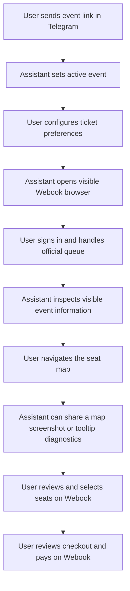

# Webook Booking Assistant

<p align="center">
  <strong>A Telegram-based assistant for exploring Webook events through a visible browser session.</strong>
  <br />
  Configure your preferences in Telegram, inspect event information, and continue the booking yourself on the official Webook website.
</p>

<p align="center">
  
  
  
  
  <a href="https://github.com/teva-12/webook-assistant/actions/workflows/tests.yml"></a>
</p>

## Overview

Webook Booking Assistant is a local Python project that connects a Telegram bot to a visible Chromium browser. It helps a user prepare for a Webook event, keep ticket preferences in one place, inspect information displayed on the event page, and share a view of the seat map.

The goal is to make the journey easier to follow without taking control away from the user. The browser stays visible, and the user completes the actual booking steps on Webook.

## What it can do

- **Telegram interaction** — control the assistant through a simple chat-based flow.
- **Event link handling** — send an official Webook event URL to set the active event for your chat.
- **Ticket preferences** — record a preferred category, quantity, adjacency preference, and area/layer.
- **Visible browser session** — open the active event in Chromium on the computer running the bot.
- **Page inspection** — read visible page text and report ticket category and price pairs when they can be detected.
- **Seat-map snapshot** — share a screenshot of the currently visible seat map through Telegram.
- **Tooltip diagnostics** — inspect text exposed by visible hover tooltips. This is diagnostic information, not an automated seat-selection feature.
- **Per-chat state** — keep Telegram session state locally in `data/telegram_sessions.json`.

## How it works



## Telegram commands

| Command | Purpose |
| --- | --- |
| `/id` | Show your Telegram chat ID for the access allowlist setup. |
| `/start` | Start the bot and show the welcome flow. |
| `/help` | Show available commands and guidance. |
| `/book` | Set ticket category, quantity, adjacency preference, and preferred area/layer. |
| `/open` | Open the active event in a visible browser window. |
| `/inspect` | Inspect visible page text and report detectable category/price information. |
| `/map` | Send a screenshot of the currently visible seat map. |
| `/scan` | Collect visible hover-tooltip text for initial seat-map diagnostics. |
| `/status` | Show the current session status. |
| `/cancel` | Cancel the current preference flow. |
| `/payment` | Record that you have reached the payment stage; it does not verify payment. |

You can also send an official Webook event URL directly in the chat. Setting a new event clears the previous event's ticket preferences for that chat.

## Typical workflow

1. Start the bot with `/start`.
2. Send the Webook event URL.
3. Run `/book` and enter your ticket preferences.
4. Run `/open` to launch the event in the visible browser.
5. Sign in and complete any queue or CAPTCHA yourself.
6. Run `/inspect` to review information visible on the page.
7. Navigate to the seat map yourself, choose the layer, and zoom to the area you want to inspect.
8. Use `/map` to share the current map view, or `/scan` to collect visible hover-tooltip text.
9. Review and select your seats directly on Webook.
10. Continue through checkout and complete payment yourself on the official website.

## Seat-map scope

The seat-map tools are intentionally limited:

- `/map` shares the map currently visible in the browser.
- `/scan` moves the pointer over sample points in the visible canvas and collects tooltip text exposed by the page.
- The scan is an initial diagnostic aid. It does not establish real-time seat availability, physical adjacency, or a guaranteed seat match.
- The user chooses the layer, zoom level, seats, and final booking options manually.

## User control and safety

This project does **not**:

- bypass or manipulate an official queue;
- solve or bypass CAPTCHA;
- automate sign-in;
- click or select seats;
- submit an order;
- make a payment.

The browser is visible so the user can review each step. Authentication, queue handling, seat selection, checkout confirmation, and payment remain under the user's direct control. The assistant does not claim that a booking or payment succeeded.

## Requirements

- Windows
- Python 3.14
- A Telegram bot token created with Telegram's official `@BotFather`
- Chromium installed through the project's Playwright setup script

The Telegram bot and browser should run on the same computer for browser commands to work.

## Installation

### 1. Clone the repository

```powershell
git clone https://github.com/teva-12/webook-assistant.git
cd webook-assistant
```

### 2. Create and activate a virtual environment

```powershell
py -3.14 -m venv .venv
.\.venv\Scripts\Activate.ps1
```

### 3. Install dependencies

```powershell
python -m pip install --upgrade pip
python -m pip install -r requirements.txt
```

### 4. Configure the bot

Create a `.env` file in the project root. Add your Telegram bot token and your own Telegram chat ID:

```env
TELEGRAM_BOT_TOKEN=YOUR_TELEGRAM_BOT_TOKEN
TELEGRAM_CHAT_ID=YOUR_TELEGRAM_CHAT_ID
```

Keep your token private. Do not commit `.env` or share it in screenshots or messages. To get your chat ID, start the bot and send `/id`. Copy the number into `TELEGRAM_CHAT_ID` and restart the bot. The bot fails closed: if the allowlist is empty, only `/id` works. You can authorize multiple chats by separating IDs with commas.

### 5. Install the browser

Run the setup script once:

```powershell
.\setup_browser.bat
```

### 6. Start the bot

```powershell
.\run_telegram_bot.bat
```

Then open your bot in Telegram and press **Start**.

## Run manually

If you prefer to start the bot from the terminal:

```powershell
.\.venv\Scripts\python.exe -m app.telegram_bot
```

## Run tests

```powershell
.\.venv\Scripts\python.exe -m pytest -v
```

## Configuration

Check [`.env.example`](.env.example) for the available environment variables and defaults. The default event is the generic example URL and name; send another supported official Webook event URL in Telegram to change it.

## Releases

Published versions are available on the [GitHub Releases page](https://github.com/teva-12/webook-assistant/releases). To publish a version, open **Actions → Publish Release → Run workflow**, keep the default tag `v1.0.0`, and run it from `main`. The workflow creates the tag and publishes a release with generated release notes. You can also publish automatically by pushing a version tag such as `v1.0.1`.

See [`CHANGELOG.md`](CHANGELOG.md) for the project change history.

## Project structure

```text
webook-assistant/
├── app/
│   ├── booking/       # Category policy, safety guard, seat-map helpers
│   ├── browser/       # Visible persistent browser session
│   ├── core/          # Configuration and shared models
│   ├── monitoring/    # Page inspection and booking-stage tracking
│   ├── reporting/     # JSON and HTML reports
│   ├── ui/            # Terminal dashboard
│   ├── main.py        # Terminal workflow
│   └── telegram_bot.py
├── data/              # Local Telegram state (not committed)
├── logs/              # Local logs
├── reports/           # Generated reports
├── scripts/           # Setup and diagnostic scripts
├── tests/             # Automated tests
├── .env.example
├── requirements.txt
├── setup_browser.bat
└── run_telegram_bot.bat
```

## Current limitations

This is a local assistant for a specific event-booking workflow, not a general-purpose ticketing platform. Webook page layouts and seat-map behavior can change, so inspection results depend on what the site currently exposes in the visible browser. Tooltip scanning is experimental/diagnostic and should not be treated as a source of guaranteed availability.

## Contributing

Issues and suggestions are welcome. If you report a problem, include the command you used, what you expected to happen, and the relevant error message. Never include bot tokens, account credentials, or other private information.

---

<p align="center">
  Built as a practical automation project with the user staying in control of the booking.
</p>
